# V1.1.1 視覺美化說明（鼠尾草・暖白）

> 只改畫面：記帳、資料庫（`kouda-v1`、版本 1）、備份格式（schema 1）、GPT 解析、快捷加減、左滑刪除、局部更新**都沒有動**。
> 截圖全部使用假資料（`tests/fixtures/demo-library.json`）。截圖由真實瀏覽器（Edge，手機尺寸、2 倍像素）自動操作 App 產生，不是示意圖。

## 1. 前後對照

**首頁・淺色**

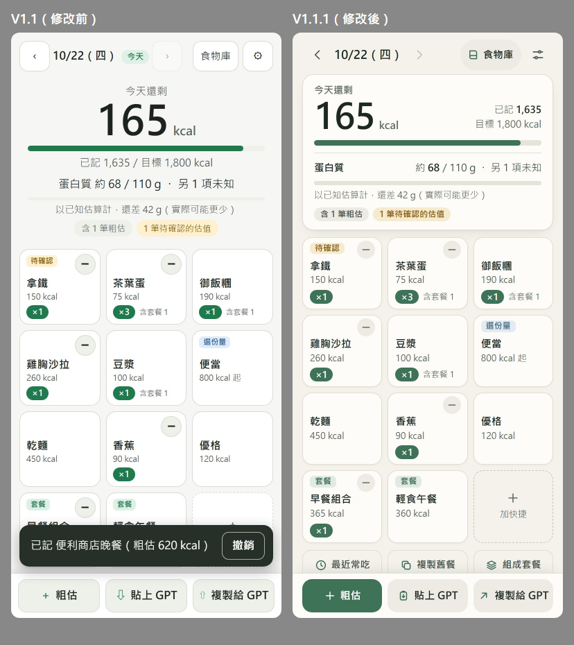

**首頁・深色**

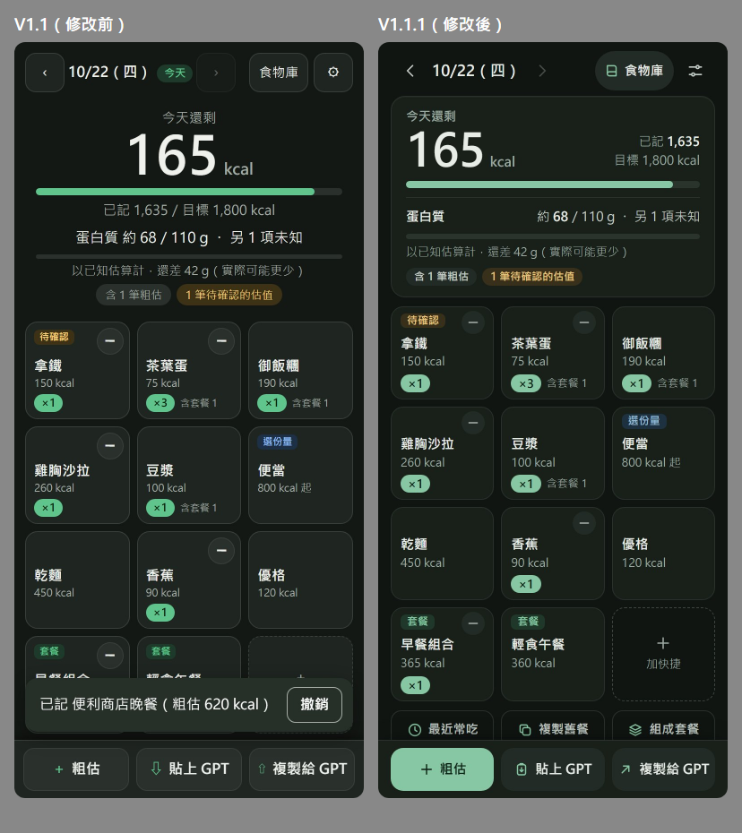

（左邊 V1.1 的畫面底下有「撤銷」提示是因為截圖時剛記完一筆。兩邊資料相同：假資料 8 筆紀錄、超過 1,800 的目標前還剩 165 kcal。）

V1.1 的主要問題：每個按鈕都有外框、頂端三個框框按鈕與兩條提示橫幅佔掉很多高度；剩餘熱量與蛋白質只是置中的文字加細線，沒有「一張摘要」的整體感；卡片上的標籤區、圓點、粗體數字大小都差不多，層級不分；用 emoji 與文字符號（🕐 💾 ⧉ ☰ ⇩ ⇧ ⋯ ✕）當圖示，在不同手機字型下粗細與大小不一。

## 2. 設計方向

- **一個品牌色**：低飽和的翡翠綠（淺色 `#3f7357`、深色改成較亮的鼠尾草綠 `#88c7a3`）。藍色只給蛋白質，琥珀色只給「待確認／未知」，紅色只給刪除與超標。
- **暖白底**：淺色底 `#f4f2eb`、卡片 `#fdfcf9`；深色是**獨立調色**的偏綠深灰（底 `#101512`、卡片 `#182019`、面板 `#1c251f`），不是把淺色反相。
- **少疊東西**：只有「今日摘要卡」和「快捷卡」用細線＋極淡陰影；清單合成一張卡，用細分隔線，不是一筆一張卡。按鈕以填色區分主次（主要＝綠、次要＝淡灰褐、輕量＝文字），不再每個都加框。
- **層級靠字重與留白**：剩餘熱量 56 px／800；卡片名稱 15 px／700，熱量 13 px 灰；清單名稱 16 px／600、熱量 17 px／700；說明文字最小 12 px。數字一律等寬數字（`tabular-nums`），變動時不會左右跳。
- **一致的形狀**：卡片 14–16 px 圓角、按鈕 12–14 px、標籤 6 px、面板上緣 22 px；圖示全部是同一套本地 SVG（描邊 1.9 px、圓角線頭），在 `app/js/ui/icons.js`，不用外部字型或圖片。
- **不靠顏色傳達狀態**：超標＝「已超過目標」＋「超標」文字；蛋白質未知＝「另 N 項未知」文字；待確認／選份量／套餐＝文字標籤；刪除鈕＝「刪除」文字。

## 3. 主要版面調整

**首頁**（`app/js/ui/home.js`）
- 頂端：日期導覽與設定改成無框圖示，「食物庫」是淡灰膠囊；日期旁的「今天」標籤在 < 430 px 隱藏（大數字上方已寫「今天還剩」），「補記」標籤永遠保留。
- 今日摘要卡：左邊大數字「今天還剩 N kcal」，右邊「已記／目標」；下面熱量進度條；細線分隔後是蛋白質（約 X／目標 g、另 N 項未知、進度條、還差多少）；最下面是「含 N 筆粗估／待確認」等小標籤。快捷格四排的總高度也從約 453 px 縮到約 432 px。
- 提示橫幅：變成一行、按鈕是文字鈕（仍有 44 px 點擊區），不再是框框按鈕。
- 快捷格：三欄最多 12 格不變。每張卡由上到下是：標籤列（套餐／選份量／待確認）、名稱（最多兩行）、熱量、數量。減號縮成 26 px 的灰色圓鈕放在右上角，點擊區 44×38 px，**畫面上不會壓到名稱或標籤**（已用程式在 320／360／390 px 量測）。套餐卡**沒有**綠框，只有「套餐」標籤；數量「×3」旁寫「含套餐 1」，分清楚獨立紀錄與套餐包含的份數；窄螢幕放不下時換行，不再被截成「含套…」。
- 次要工具（最近常吃／複製舊餐／組成套餐）：細框淡色按鈕＋圖示，比卡片安靜。
- 今日清單：一張卡、細分隔線。左邊時間、中間名稱＋份數＋來源／蛋白質、右邊熱量與 `⋯`。套餐列有展開箭頭與「套餐」標籤，展開後的子項縮排、底色略深、左側有細線。左滑露出的刪除鈕是深紅底白字。
- 底部操作列：三顆等寬按鈕＋圖示；「＋ 粗估」是唯一的綠色實心主按鈕，另兩顆是淡灰。

**面板與表單**（`app/css/app.css`、`util.js`）：頂端有拖曳條樣式的小把手，標題 18 px，關閉鈕改成圖示；輸入框 48 px 高、暖灰底、聚焦時綠色外框；選項按鈕（偏少／一般／偏多、0.5／1／2）選中＝綠底白字；危險按鈕＝淡紅底紅字。提示（Toast）在面板開著時移到畫面上方，不再蓋住面板底部的主要按鈕。

**食物庫／設定／首次使用**（`pages.js`）：食物庫有搜尋圖示、「記入」是淡綠鈕、「編輯」是文字鈕，食物來源與「在快捷格」另起一行；設定頁的區塊是統一的卡片，快捷格排列用上下箭頭圖示，「還原備份（完整取代）」用淡紅底提醒；首次使用有品牌標誌（與 PWA 圖示同一個額度環）。

**PWA**：圖示改成新的品牌綠（`tools/make-icons.py` 重新產生）；`theme-color` 依淺／深色主題分別設成對應底色；manifest 的 `background_color`／`theme_color` 同為暖白。

## 4. 新版畫面（390 px 手機，假資料）

| 淺色 | 深色 |
|---|---|
| 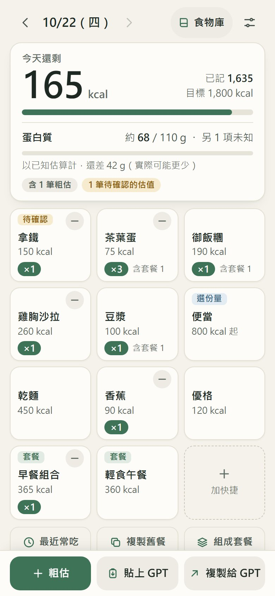 | 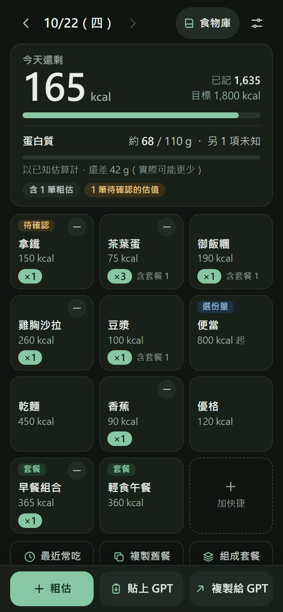 |
| 今日清單（含展開的套餐） | 今日清單（深色） |
| 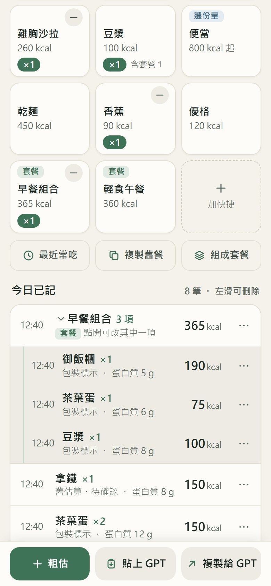 | 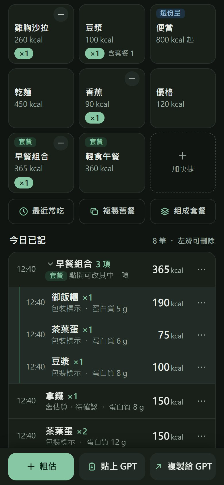 |
| 左滑露出「刪除」（淺色） | 左滑露出「刪除」（深色） |
| 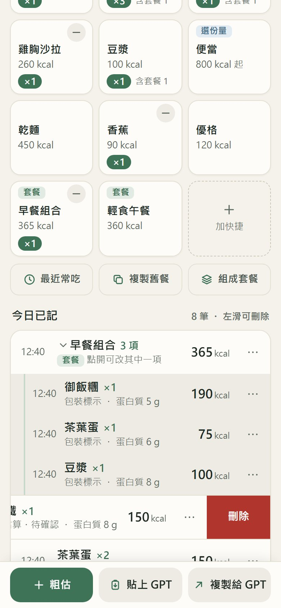 | 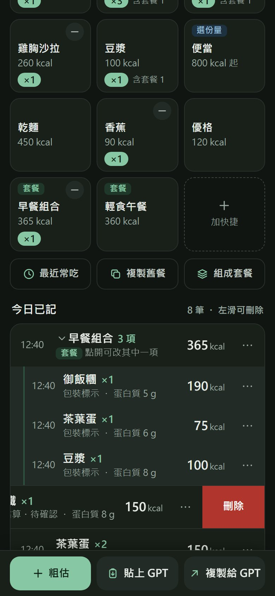 |
| 食物庫（淺色；V1.1 見 `before-library-light.jpg`） | 食物庫（深色） |
| 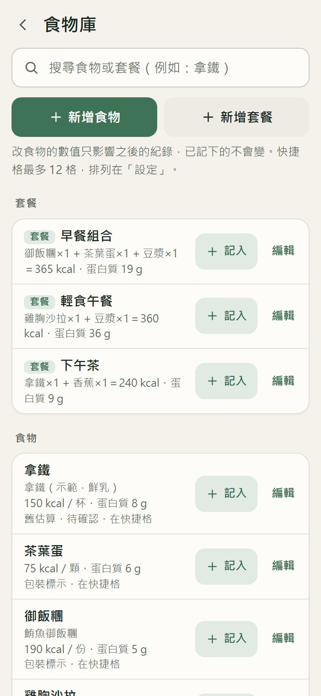 | 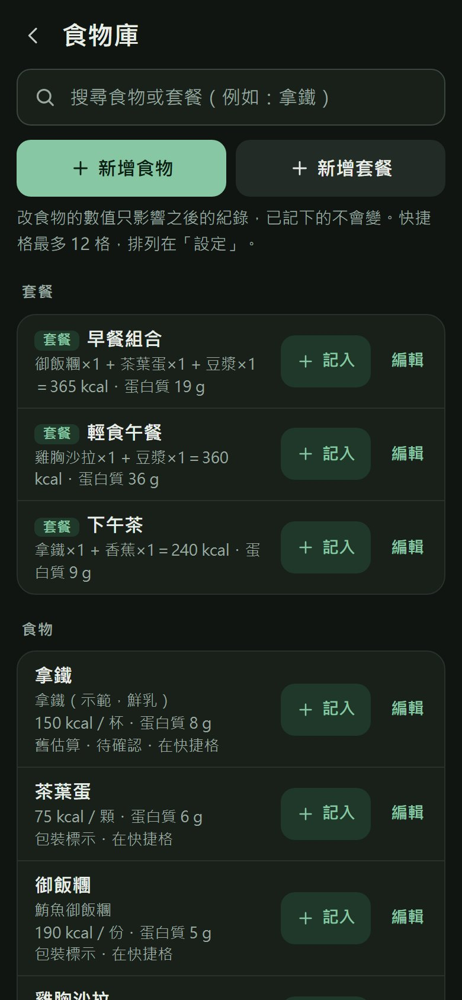 |
| 設定（淺色；V1.1 見 `before-settings-light.jpg`） | 設定（深色） |
| 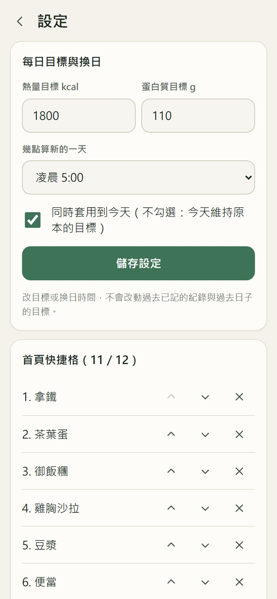 | 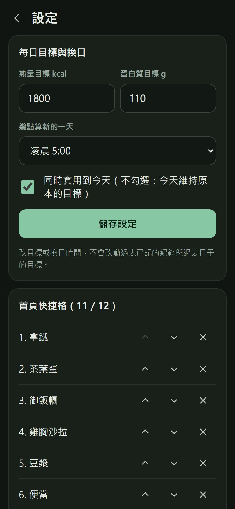 |
| 複製給 GPT（淺色） | 從 GPT 加入（深色，已解析待確認清單） |
| 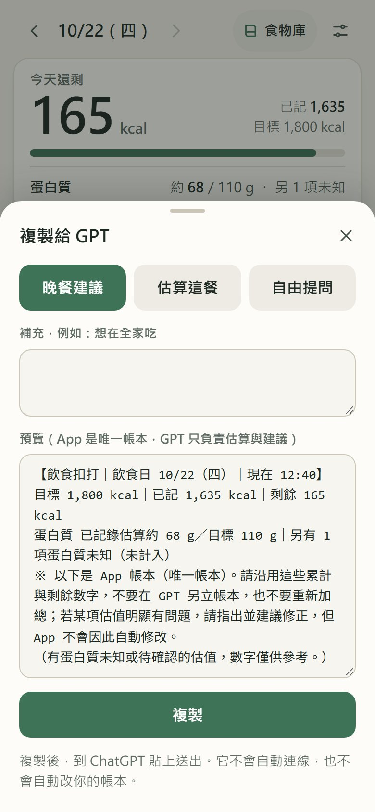 | 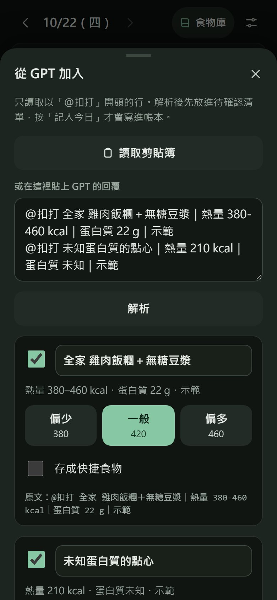 |
| 把今日已記組成套餐（淺色） | 最近／常吃（深色） |
| 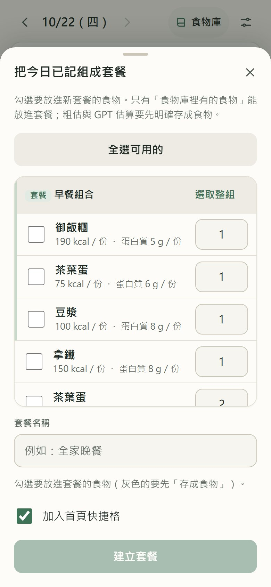 | 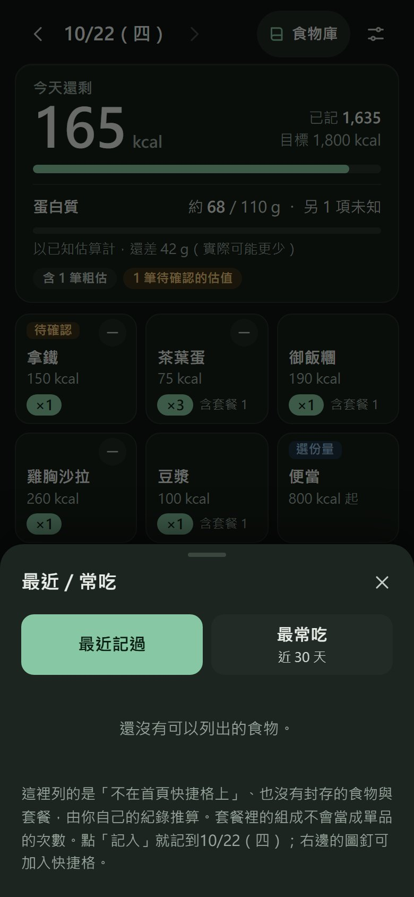 |
| 首次使用（淺色） | 320 px 窄螢幕＋8 字長名稱＋超標狀態 |
| 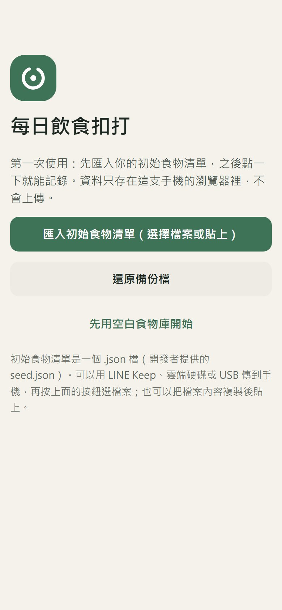 | 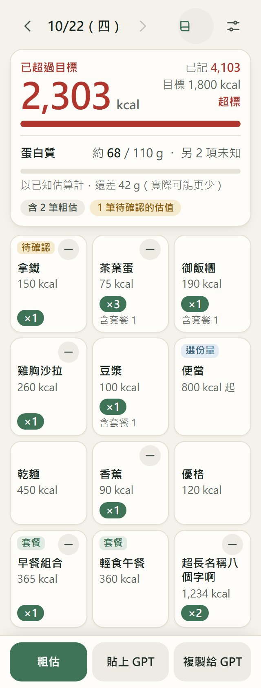 |

桌面寬度（1280 px）：內容固定在 560 px 寬置中，底部操作列與內容對齊。

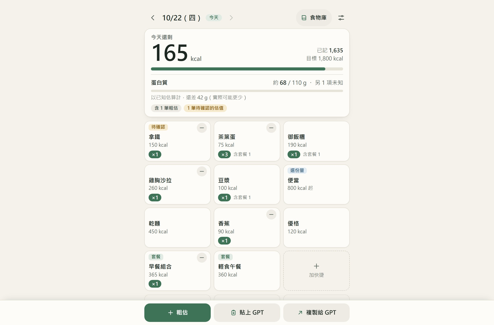

## 5. 手機尺寸檢查

用真實瀏覽器在 **320、360、390、430 px 與 1280 px 桌面**、淺色與深色各跑一次完整流程（首次匯入 → 記錄 → 左滑 → 各面板 → 食物庫 → 設定），每個畫面自動量測：

- 橫向溢出：全部 0（頁面與面板內沒有任何元素超出視窗）。共 72 次自動量測（8 個畫面或面板，含 8 字長名稱壓力測試 × 9 組尺寸與主題），零問題。
- 功能抽查（真實瀏覽器、同一套 JavaScript）：卡片減號 ×3 → ×2，按「撤銷」回到 ×3；用觸控指標事件左滑，列停在露出「刪除」的位置；點「便當」開啟偏少／一般／偏多面板。
- 觸控目標：所有按鈕、輸入框、列都 ≥ 44×44 px；**唯一例外是卡片減號的點擊區 44×38 px**——高度刻意縮短，才不會蓋到下面的名稱（畫面上的圓鈕 26 px）。
- 減號與名稱／標籤：重疊 0；名稱最多兩行，不被截斷。
- 對比度（`tests/ui-visual.test.js` 以 token 實際計算）：文字與背景 ≥ 4.5:1（WCAG AA），淺、深兩套主題各 26 組配色全部通過，包含深色上的紅色刪除鈕（白字／`#b0362d`＝6.2:1）、標籤與灰色說明文字。
- `prefers-reduced-motion`、`env(safe-area-inset-*)`、底部操作列不遮最後一筆（頁面底部保留操作列高度＋安全區）都保留。

## 6. 動畫

維持 V1.1 的行為（先更新帳本，再播動畫），時間都在 0.15–0.3 秒：卡片按下縮放 0.12 s、+1／−1 飄起（0.7 s 淡出，只是提示）、數字與進度條平滑變化 0.26–0.28 s、清單進退場 0.22 s、面板滑入 0.24 s／滑出 0.19 s。卡片「記入成功」閃光縮短為 0.26 s，數量脈動縮短為 0.28 s。`prefers-reduced-motion: reduce` 時全部關閉。

## 7. 修改的檔案

- 樣式：`app/css/app.css`（整份重寫，token 在檔案最上面，分成 ①token ②基礎 ③共用元件 ④首頁 ⑤面板與表單 ⑥食物庫與設定 ⑦動畫）
- 新增：`app/js/ui/icons.js`（本地 SVG 圖示與品牌標誌）、`tests/ui-visual.test.js`（11 項 UI 回歸測試）
- 樣板（只改標籤結構、class 與圖示，**保留所有 `data-act`／`data-id`／`data-key`／`data-enter`／`data-leave`／`data-tween`／`data-pulse`／`data-keepstate` 屬性**）：`app/js/ui/home.js`、`pages.js`、`sheets.js`、`smart.js`、`util.js`
- PWA：`app/index.html`（theme-color）、`app/manifest.webmanifest`（顏色）、`app/icons/*.png`、`tools/make-icons.py`、`app/sw.js`（版本戳記）
- **沒有動**：`app/js/core/*`、`app/js/state.js`、`app/js/store/*`、`app/js/ui/{index,morph,swipe}.js`、資料庫與備份格式、`.github/workflows/pages.yml`

## 8. 需要在 Android 實機驗收

自動化截圖用的是桌面 Edge 的手機模擬，下面幾項只能在真手機確認：

1. 中文字型：模擬器用微軟正黑體，實機是 Noto Sans CJK（字形略不同，行高與換行位置可能差一點）。
2. 減號手感（點擊區 44×38 px）、左滑與上下捲動、長按快捷卡（約 0.55 秒）。
3. 鍵盤彈出時面板內欄位是否被遮住（食物編輯、粗估、複製舊餐搜尋、組成套餐名稱）。
4. 狀態列顏色：深色模式下 PWA 開啟時狀態列是否與背景一致（`theme-color` 依主題分兩個）。
5. 已安裝的 App 的圖示是否更新（Android 有時要重新「加到主畫面」才換圖示）。

## 9. 發布到 GitHub Pages

本分支只在本機：`feature/ui-polish`。你審核後自行推送與合併：

```bash
git push -u origin feature/ui-polish
```

合併到 `main` 才會觸發 Actions（先跑 `npm test` 與版本戳記檢查）再部署。已安裝的手機打開時會出現「已有新版本 → 重新載入」，**不會動到食物與紀錄**。畫面版本號仍顯示 1.1.0（版本字串在 `app/js/core/backup.js`，依規定這次不碰核心）。
