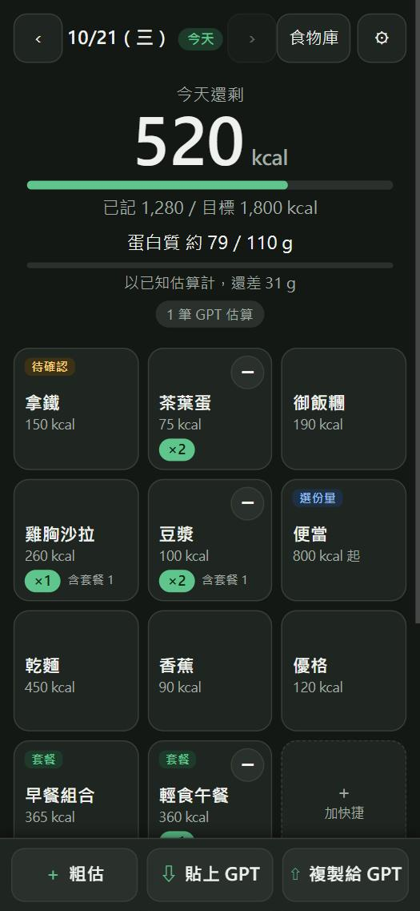
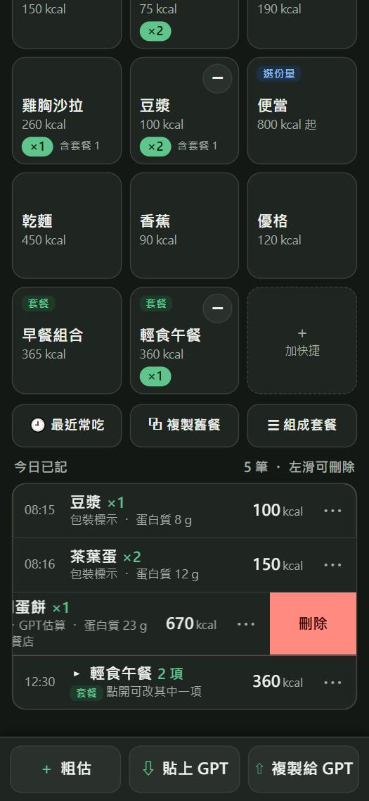
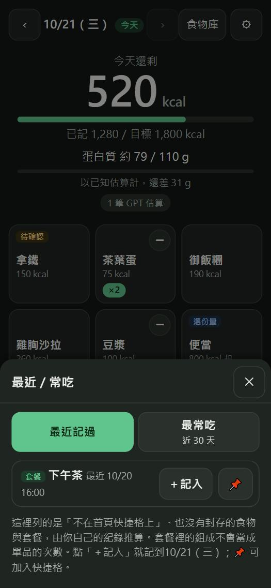
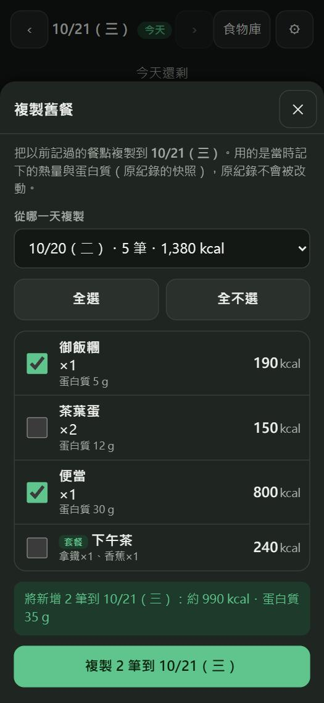
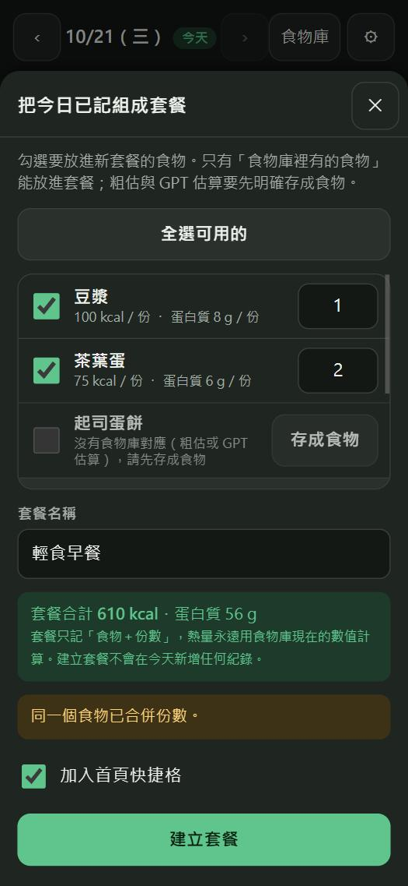
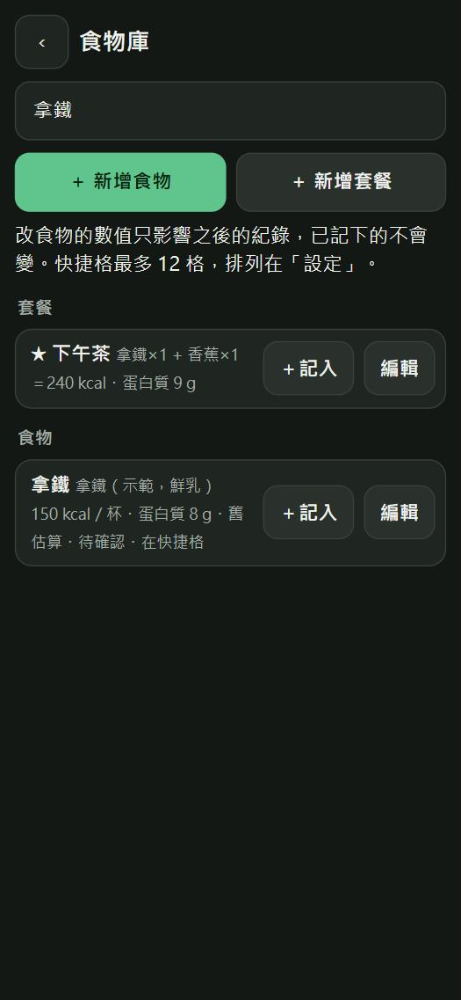

# 每日飲食扣打 V1.1 操作說明

> 截圖全部使用**假資料**（`tests/fixtures/demo-library.json` 的示範食物），不是任何人的飲食紀錄。
> V1 的操作（匯入食物清單、貼上 GPT、複製給 GPT、備份還原）完全不變，見 [README](../README.md)。

## 1. 首頁：一眼看到「今天還剩多少」

- 最上面的大數字是**今天還剩多少 kcal**，下面有熱量進度條。超過目標時數字變紅、顯示「已超過目標」，進度條也變紅。
- 蛋白質有自己的細進度條。只要有蛋白質未知的項目，就會寫「另 N 項未知」，**不會當成 0**。
- 快捷卡片是三欄，每張卡片都用短標籤標示類型：
  - 綠色「**套餐**」：一次記一組。
  - 藍色「**選份量**」：整餐模板，點了先選偏少／一般／偏多。
  - 黃色「**待確認**」：數值還是暫定的估值。

## 2. 新增與減少（卡片的 ＋／−）

| 想做的事 | 怎麼做 |
|---|---|
| 記一份 | 點**卡片主區**（任何地方，除了右上角圓形的減號）。卡片會輕輕縮一下，飄起「+1」，大數字平滑地往下變。 |
| 減一份 | 點卡片**右上角的「−」**。飄起「−1」，底下出現「撤銷」。 |
| 一次記一整組套餐 | 點套餐卡片。 |
| 減一整組套餐 | 點套餐卡片的「−」：只拿掉**最近的一整組**，不會只扣掉其中一項。 |
| 份數不是 1 | 長按卡片主區，選 0.5／1／2 或自訂。 |
| 選份量的整餐 | 點卡片 → 選偏少／一般／偏多。 |

**減號只會動「你自己單獨記下的」份數。** 例如你先點茶葉蛋 2 次，又點了「早餐組合」（裡面也有一顆茶葉蛋）：

- 茶葉蛋卡片會顯示 `×3  含套餐 1`（今天一共吃了 3 顆，其中 1 顆在套餐裡）。
- 按茶葉蛋的減號，只會減你單獨記的 2 顆；套餐裡那一顆不會被動到。
- 如果今天只有套餐裡有茶葉蛋，茶葉蛋卡片就**不會有減號**（避免誤刪套餐組成）。要拿掉就用套餐卡片的減號，或到清單裡編輯。

份量只剩 0.5 或 1 時再按減號，那一筆會整筆拿掉，不會變成負數。粗估與 GPT 估算的紀錄不會被單品的減號減掉。

## 3. 今日清單：左滑刪除

- **短短往左滑**：露出紅色「刪除」按鈕（再點一下才刪）。點那一列或往上下捲動，就會收回去。
- **一路滑到底再放開**：直接刪除，下面出現「撤銷」。
- 套餐那一列（有「套餐」標籤）左滑會刪除**整組**；點它可以展開，展開後的每一項用「⋯」編輯，不能單獨左滑。
- 一般點一下是編輯，「⋯」也還在。只有「水平往左」的動作才會被當成左滑；上下捲動、長按、點擊都不受影響。螢幕邊緣的系統手勢由 Android 先處理，「⋯」按鈕上也不會啟動左滑（實機手感請在手機上確認）。
- 刪除沒成功（資料庫寫入失敗）時，那一列會滑回原位並顯示錯誤，帳本不會變。

## 4. 撤銷

加、減、刪除、複製、建套餐都有「撤銷」，在畫面下方出現約 6 秒。撤銷會**精確**還原：同樣的紀錄、同樣的 ID、同樣的營養快照、同樣的套餐群組。

## 5. 最近／常吃

點首頁的「🕘 最近常吃」。

- **最近記過**：依你最近一次記錄的時間排序。
- **最常吃**：最近 30 個飲食日內，你單獨記了幾次（連點合併成一筆算一次）。
- 只列出**不在首頁快捷格上**的食物與套餐；封存的不會出現。套餐裡的組成**不算**單品的使用次數（所以茶葉蛋不會因為你常點早餐組合而排在前面）。
- 「＋記入」直接記到目前的飲食日（選份量的整餐會先問份量）；「📌」加入首頁快捷格（滿了就沒有這個按鈕）。

## 6. 複製舊餐

點首頁的「⧉ 複製舊餐」。

1. 預設選「上一個有紀錄的日子」，也可以用下拉選單換成其他日子。
2. 勾選要複製的項目：單筆、或整個套餐（套餐整組一起複製）。可以「全選」。
3. 下面會預覽「將新增 N 筆：約 X kcal・蛋白質 Y g」。按「複製」才會真的寫入。

複製出來的是**新的紀錄**：新的 ID、現在的時間、你目前正在記的那一天；套餐會建立新的群組，不會和原本那一組共用。熱量與蛋白質用的是**原紀錄當時的數字**（快照）。如果食物庫現在的數值和當時不同，預覽會列出差異，但仍然照原紀錄複製。原本那天的紀錄完全不變。

## 7. 把今天的組合存成套餐

點首頁的「☰ 組成套餐」（今天有紀錄才能按）。

1. 勾選要放進新套餐的食物（可以改份數；同一個食物會合併）。套餐裡的每一項都可以個別勾選。
2. 沒有食物庫對應的項目（粗估、GPT 估算）顯示成灰色，並寫明原因。要用它，先按那一列的「**存成食物**」（會在食物庫新增一個食物，**不會改動原來那筆紀錄**），之後就能勾選。
3. 輸入套餐名稱。下面會即時顯示合計 kcal／蛋白質。
4. 套餐只存「食物＋份數」，**不存熱量**，之後記入時用食物庫當下的數值計算。如果食物庫現在的數值和今天記的不同，會列出提醒。
5. 已經有同名、或相同內容的套餐時會擋下來並說明。可選擇是否加入首頁快捷格（滿了就不能勾）。
6. 按「建立套餐」：**不會在今天新增任何紀錄**。

## 8. 食物庫搜尋

食物庫頁面最上面有搜尋框。

- 一邊打字一邊過濾食物與套餐；找的是名稱（短名、完整名稱、套餐裡的食物名）。
- 前後空白、英文大小寫、全形半形都可以；打兩個詞表示兩個都要對上。
- 找不到時會出現「＋ 新增食物『…』」，名稱已經幫你填好。
- 結果裡的「＋記入」「編輯」和原本一樣。搜尋完全在手機上進行，不會傳出任何東西。

## 9. 動畫

- 動畫都很短（約 0.15–0.25 秒）：卡片按下縮放、+1／−1 飄起、大數字與進度條平滑變化、清單新增／刪除、底部面板滑入滑出。
- 動畫不會擋住操作：快速連點照樣正確累加，帳本永遠立即更新。
- 如果手機開了「**移除動畫／減少動態效果**」（Android 的無障礙設定），所有非必要動畫都會關掉，功能完全一樣。
